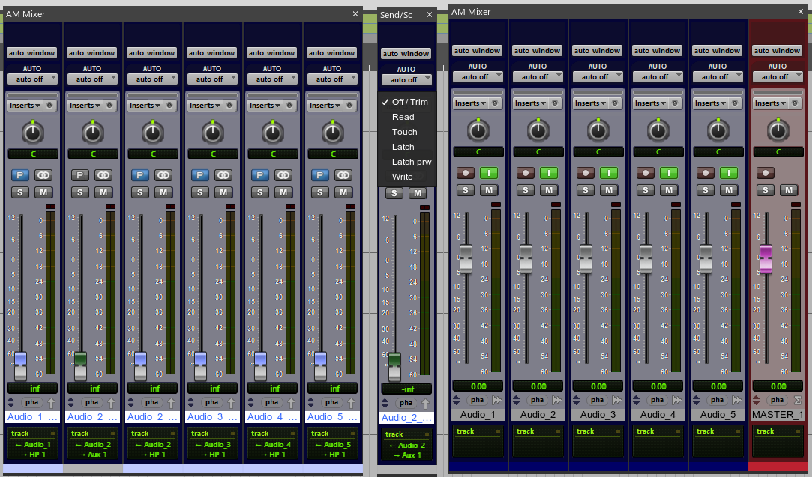

[readme_github_main.md](https://github.com/user-attachments/files/34439711/readme_github_main.md)
# Pro Per (Beta 1.7.83) for REAPER 7

> **Pro tools done right, with REAPER ;-)**
> 
> *Pro Per is not just an aesthetic GUI skin for REAPER 7. It is a deep functional overhaul designed to bring the missing historical workflows of Pro Tools Ultimate directly into REAPER's rock-solid engine.*

---

## Overview & Presentation

Watch the official overview video to see **Pro Per** in action:

---

## Screenshots

| Pro Tools Ultimate GUI & Transport | 
| :---: |
|  | 
| :---: |
 |

| Emulated True QuickPunch (Lanes) | Perfect Timing (Beat Detective Integration) |
| :---: | :---: |
|  |  |

*(Note: Replace `docs/images/...` paths above with the actual relative paths of your screenshots uploaded to GitHub)*

---

##  Key Features & Historical Fixes

###  1. Emulated True QuickPunch Engine
Built natively on REAPER’s **Fixed Item Lanes** system to achieve genuine Pro Tools Tape Auto monitoring and seamless background recording:
* **Tape Auto Monitoring:** Mutes live inputs during playback and unmutes automatically at punch-in.
* **Background Pass Retention:** Non-destructive capture from Play to Stop. Retrieve pre/post audio by simply trimming item edges.
* **Safety Reference Lanes (`!OR`):** Automatic backup of raw continuous passes preserved below your active comp/punch lanes.

###  2. Control Tracks & Advanced Routing Architecture
* **Hidden Control Layer (`SND`, `SC`, `HPS`):** Clean up your main track view. Track sends generate background control tracks that move magnetically with their parent tracks.
* **RealmGui Send Floating Faders:** Control sends, sidechains, and cue mixes via ultra-responsive floating popup faders.
* **Dedicated HP Master Cue Buses:** Isolated headphone monitoring setups with dedicated artist soloing (`Hs`).
* **Contextual Folder Generation & Session Import:** Direct routing setups upon folder creation and a custom MPL-forked *Import Session Data* dialog.

###  3. Edit Modes & Smart Tools
* **Contextual Smart Tool:** Seamless switching between Trim, Selector, and Grabber based on mouse height over the track lane.
* **Pro Tools Transport & Numeric Keypad Mapping:** Full mirror mapping of classic numeric keypad operations (0: Play/Stop, 1-2: Fast Forward/Rewind, 3: Punch-in/out, etc.).
* **Edit Modes:** Dedicated buttons for Slip, Spot (with numerical dialog), Grid, and Dual-Stage Shuffle (Per-track / All-tracks).

###  4. Advanced CPU & Freeze Workflow
* **Smart Freeze & Visual Tagging:** Freeze up to a specific plugin insert chain. Tracks display status indicators (`Ed` for Edits, `fx` for Item FX, `env` for Envelopes) directly in empty FX slots.
* **Make Inactive / Track Commit:** Completely unload CPU processing threads while preserving full session structures.

---

##  Mandatory System Requirements

To ensure proper macro execution and state tracking, your system **must** meet the following conditions:

1. **REAPER Interface Language:** Strictly set to **English** (custom Lua scripts rely on English string parsing).
2. **Minimum Display Resolution:** $1920 \times 1080p$ (Includes optimized HiDPI `$150\%$` and `$200\%$` layouts).
3. **Required ReaPack Extensions:**
   - **SWS Extension**
   - **JS_ReaScriptAPI**
   - **RealmGui**

---

##  Essential Keyboard Shortcuts

| Action | macOS Shortcut | Windows Shortcut |
| :--- | :--- | :--- |
| **New Track Terminal** | `Cmd + Shift + N` | `Ctrl + Shift + N` |
| **Duplicate Tracks** | `Cmd + Ctrl + \` | `Ctrl + Start + \` |
| **New Lane (Playlist)** | `Option + \` | `Alt + \` |
| **Spot Dialog** | `F3` | `F3` |
| **Smart Tool** | `Alt + F8` | `Alt + F8` |
| **Beat Detective (Perfect Timing)**| `Cmd + 8` | `Ctrl + 8` |
| **Toggle Control Tracks** | `Ctrl + W` / `Ctrl + E` | `Ctrl + W` / `Ctrl + E` |

---

##  User Manual & Documentation

For an in-depth breakdown of system routing, surround configuration, track freezing, and beta constraints, please refer to the included PDF manual:
* [`pro_per_user_manual_beta_1_7_83.pdf`](docs/pro_per_user_manual_beta_1_7_83.pdf)

---

##  Credits & Acknowledgments

Created with love by **AMK**.
* Special thanks to the REAPER scripting community (**MPL**, **SWS team**, **Cockos**).
* All right reserved to Cockos Incorporated for REAPER base platform.

## How to Get Pro Per

**Pro Per (Beta 1.7.83)** is currently distributed as an exclusive release for audio engineers, mixers, and post-production professionals. 

To protect the ongoing development of the custom Lua scripting engine and maintain a direct channel with active beta testers, the setup files are delivered personally upon request.

### Request Access via Instagram

If you want to try the configuration, test the Pro Tools workflow engine inside REAPER 7, or report feedback:

1. Send a Direct Message (DM) on Instagram: **[@andreamk76](https://instagram.com/andrea_mk76)**
2. Mention your main use case (e.g., Music Production, Film Post-Production, Tracking/Editing).
3. You will receive the direct download link for the full configuration package and installation guide.

---

> **Note for Testers:** Community feedback is essential to refining the workflow. Feel free to send your impressions, custom action requests, or bug reports directly via DM!
